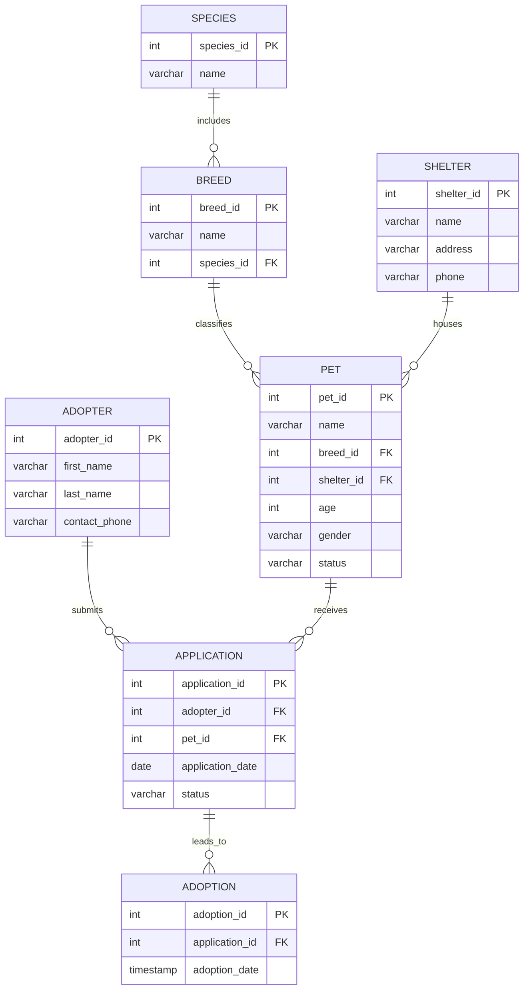

# Pet Adoption System

A PostgreSQL database for managing animal shelters, pets and adoption applications.

## Database structure

7 tables with 117 sample records.



## SQL queries

[queries.sql](queries.sql) contains 21 examples covering:

- Joins
- Aggregation and grouping
- Subqueries
- Window functions (`RANK`, `LAG`, moving averages)

## Run

1. Create an empty PostgreSQL database named `pet_adoption`.
2. Run `schema.sql` in pgAdmin Query Tool.
3. Run `sample_data.sql` in the same database.
4. Select and run examples from `queries.sql`.

Or use psql after creating the database:

```sh
psql -X -v ON_ERROR_STOP=1 -d pet_adoption -f schema.sql
psql -X -v ON_ERROR_STOP=1 -d pet_adoption -f sample_data.sql
psql -X -v ON_ERROR_STOP=1 -d pet_adoption -f queries.sql
```

Based on my database coursework. Sample data was anonymized and corrected for consistency, and a few queries were adjusted.
