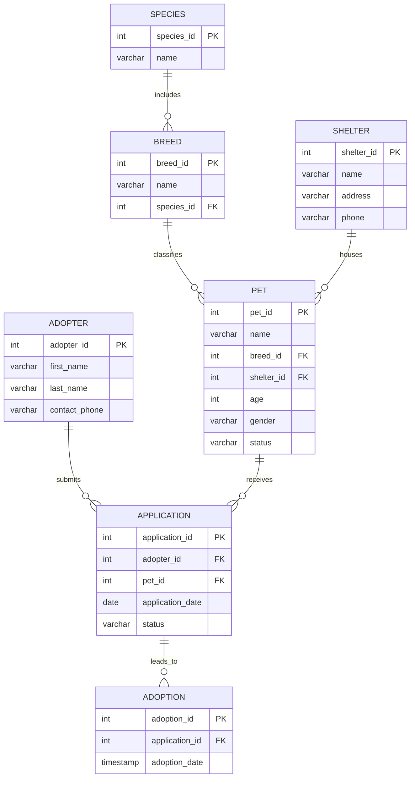

# Pet Adoption System

A PostgreSQL relational database for managing animal shelters, pets, adoption applications and adoption records. Developed as part of my Computer Science coursework at Astana IT University in 2026.

## Database structure

The database contains 7 tables, 117 sample records, 7 primary keys and 6 foreign keys.



| Table | Records |
| --- | ---: |
| species | 3 |
| breed | 6 |
| shelter | 5 |
| pet | 30 |
| adopter | 30 |
| application | 33 |
| adoption | 10 |

## SQL examples

`queries.sql` includes 21 read-only examples covering:

- INNER, NATURAL, CROSS and self joins
- Aggregation with `COUNT`, `SUM`, `AVG`, `GROUP BY` and `HAVING`
- Subqueries, `IN`, `EXISTS` and `ALL`
- Window functions: `RANK`, `LAG` and moving averages

## Getting started

Requires PostgreSQL and pgAdmin (or the `psql` command-line client).

1. Create a new empty database named `pet_adoption`.
2. Open Query Tool for that database and execute `schema.sql`.
3. Execute `sample_data.sql` in the same database.
4. Open `queries.sql`, select an example and execute it to see the results.

Alternatively, run these commands after creating the empty database:

```sh
psql -X -v ON_ERROR_STOP=1 -d pet_adoption -f schema.sql
psql -X -v ON_ERROR_STOP=1 -d pet_adoption -f sample_data.sql
psql -X -v ON_ERROR_STOP=1 -d pet_adoption -f queries.sql
```

## Project notes

This portfolio version retains the original coursework schema and uses selected queries recovered from pgAdmin history. Contact information was replaced with fictional placeholders. Sample breed labels, one adoption date, seven pet statuses and one application status were adjusted for consistency. Two natural joins were changed to explicit foreign-key joins, and a tie-breaker was added to the moving-average query. The project was originally exported from PostgreSQL 18.1. It is an academic database, not a production application.
